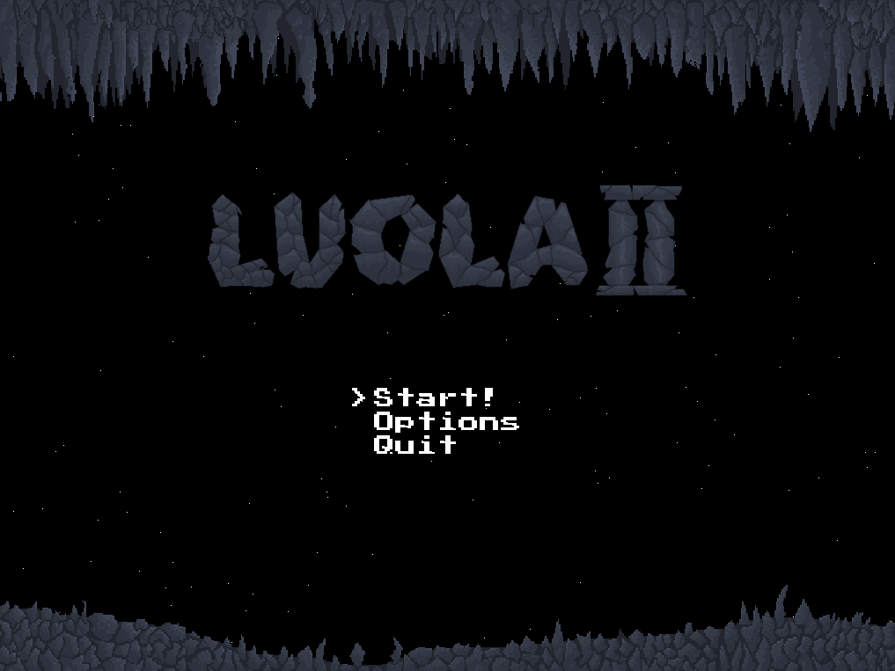
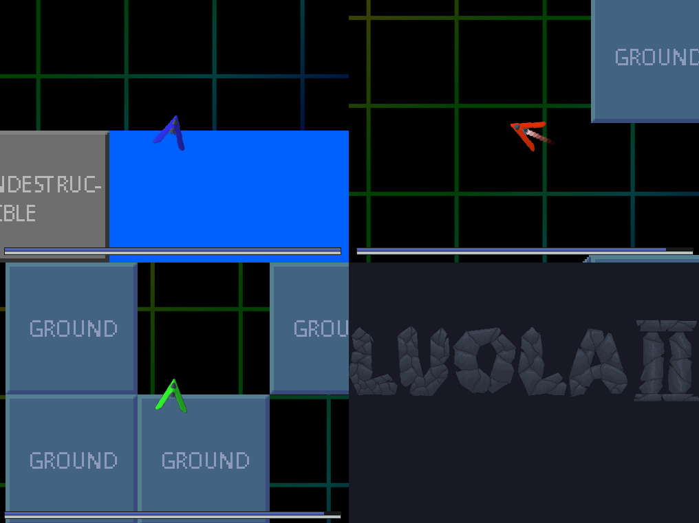

Luola II
--------

A fast-paced cave flying splitscreen game for 2+ players.

Luola II is a modernized remake of the original [Luola](https://github.com/callaa/luola), which itself was a clone of/homage to the cave flyers popular in the Finnish shareware scene of the mid 1990s.

Features:

 * Splitscreen play for 2+ players
 * Configurable key bindings for 4 players
 * Gamepad support
 * Pilot ejection for platformer mode!
 * Lua scripting, including per-level custom scripts
 * 24 special weapons to choose from
 * Destructible terrain with special effects such as falling sand simulation
 * 100% artisanal code and art: no gen-AI used!

## Roadmap to 1.0.0

The "finished" 1.0 version will have all the good features from Luola, as well as few new ones.

Planned features:

 * Music
 * Special playmodes such as timed battle with sudden death

## Instructions

**Key bindings:** up to 4 players can share a keyboard. Key bindings are customizable.

The following keys can be used in menus:

 * Arrow keys: move cursor or change numeric value
 * Enter, or any player's Fire1 button: select menu item
 * Esc: return to previous menu
 * F12: screenshot

The following non-player keys can be used in-game:

 * Esc: pause the game
 * F11: toggle debug visualizations
 * F12: screenshot

**Gamepad:** See the Help menu for button mappings. (Gamepad buttons are not customizable)

**Winning:**

 * Number of rounds in the game can be set in the player selection screen
 * Last player left wins the round
 * If all players are destroyed, the round ends in a draw
 * Player with most victories wins the game

## Build instructions

Dependencies:

 * Rust compiler
 * SDL 3
 * SDL 3 Mixer
 * SDL 3 TTF

Install the Rust compiler and dev packages for SDL libraries.
Run `cargo build --release` to build an optimized release binary, or
`cargo run` to quickly just run the game! (Tip: make a symlink from `data` to `target/debug/data`)
The game will look for the `data` directory in the following places:

 * Same directory as the executable
 * Location explicitly specified with the `--data <path>` argument (TODO)
 * Linux: XDG data directory (`~/.local/share/io.github.callaa.luola2/luola2/`)
